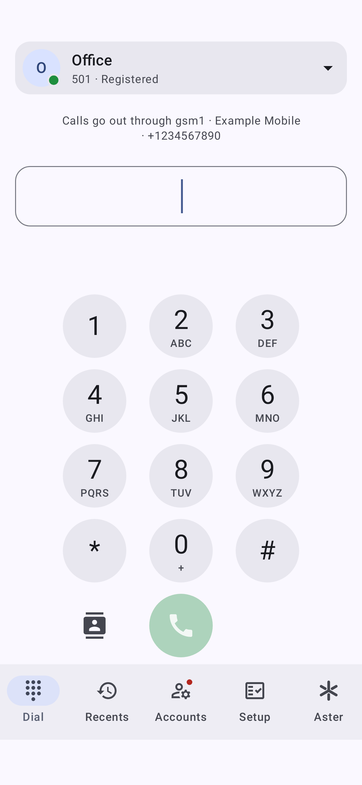
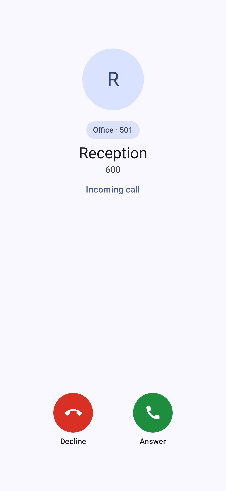
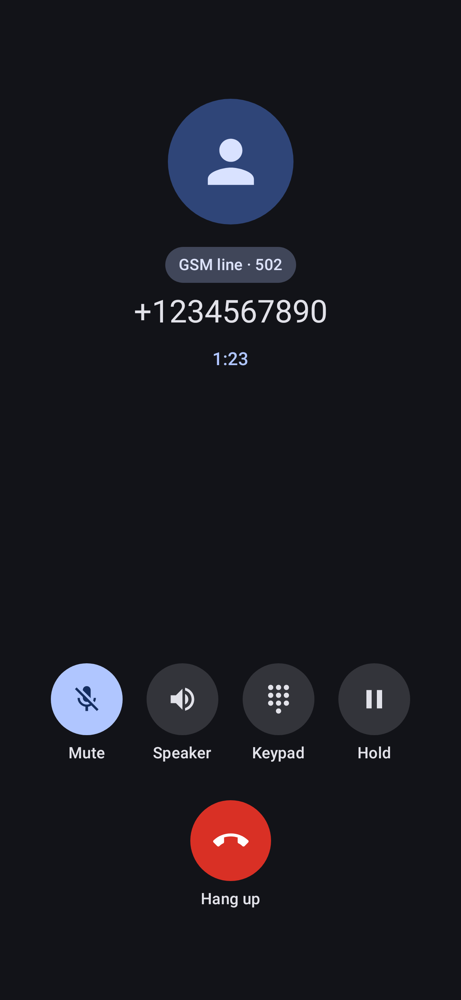
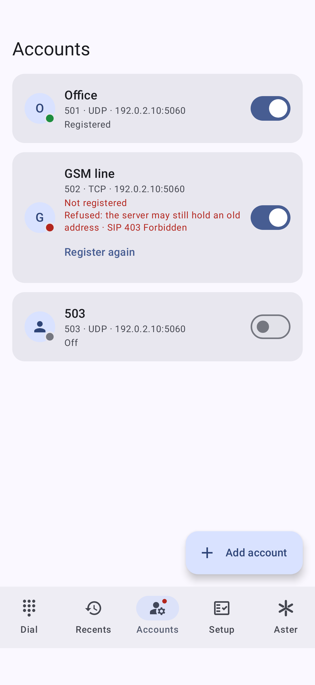
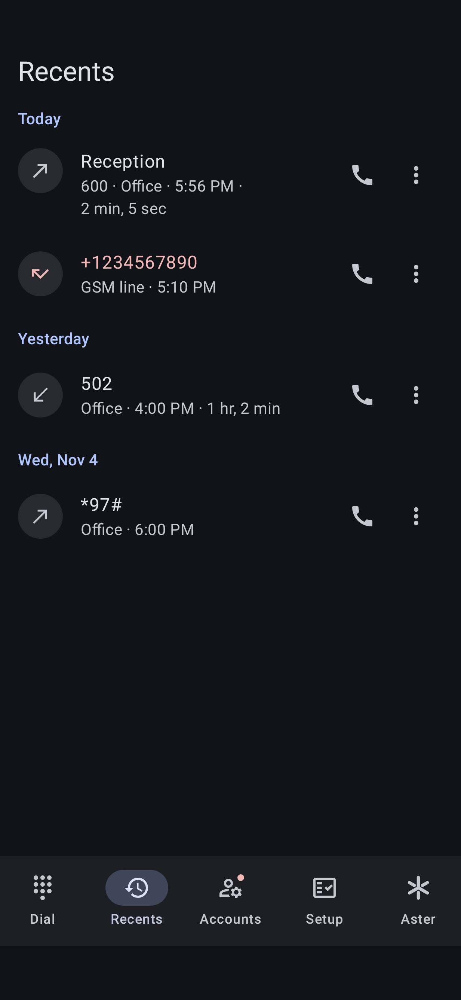
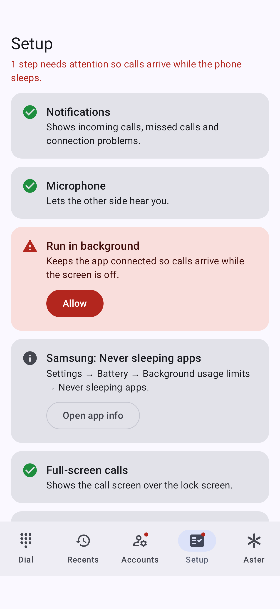

# Aster Phone

A small Android SIP softphone for one self-hosted Asterisk server, such as an Asterisk-based GSM gateway,
reached over a LAN or a VPN.

It has extra support for Aster, an Asterisk-based GSM gateway with a web panel for its phones and GSM modems:
the app can show that panel and tell which SIM a call goes out through. Without an Aster it works as a plain
SIP softphone.

<p align="center">
  
</p>

<details>
<summary>Incoming call</summary>


</details>

<details>
<summary>In a call</summary>


</details>

<details>
<summary>Accounts</summary>


</details>

<details>
<summary>Call history (dark theme)</summary>


</details>

<details>
<summary>Setup checklist</summary>


</details>

- Several SIP accounts at once, each with its own registration status. The dialer shows the account calls go
  through at the top; tapping it opens a scrollable list of all accounts, and the choice is remembered.
  Holding an account in that list opens its settings
- Receives calls in the background without push notifications or Google services
- Incoming call screen over the lock screen, mute, speaker, hold, DTMF keypad
- Calls are registered with Android's Telecom service: answering a mobile call puts the SIP call on hold,
  and Bluetooth headsets, watches and cars can answer or end it
- Names from the phone's contacts on calls, notifications and call history. While a number is typed, the
  dialer suggests matching contacts by number or by name spelled on the keypad letters; the Contacts button
  next to Call opens the phone's contact picker. Contacts are read on the phone only and never sent anywhere
- Call history: tapping an entry puts its number in the dialer, with the account it used when that is still on;
  the phone icon calls back at once through the same account
- An Aster tab with the Aster web panel, and a dialer line with the SIM the selected account calls out
  through. See [Aster tab](#aster-tab)
- A setup checklist for the Android and Samsung battery settings that would otherwise stop background calls

Calls use G.711 (PCMA/PCMU) over UDP or TCP. TLS, video and messaging are out of scope.

The launcher icon is the Aster logo, the same mark as the Aster web interface.

## Install

Download the APK from the [latest release](https://github.com/Sheepsticked/aster-phone/releases/latest) and open
it on the phone, allowing installs from that source when Android asks. Or build it from source as described under
[Building](#building). The app needs Android 10 or newer on a 64-bit ARM phone.

## Aster tab

The tab shows the Aster web panel inside the app.

- Every SIP server of your accounts is looked at for an Aster on its plain web port (`api/health`). A bar at
  the top of the tab names the panel shown. Tapping it opens a list of the Aster servers, the servers with
  none (greyed, with "Set address" for a panel on another address) and "Add Aster panel" for a panel that no
  account points at.
- Each server keeps its own page and back history, and its own login, unless two panels share a host and
  differ only by port, as web views keep cookies by host.
- The tab only loads the chosen panel's address (plain HTTP is allowed for it) and opens other links in the
  browser. An address typed without `http://` or `https://` is taken as `http://`.
- You sign in on the panel's own page and the app never stores the password. The page is closed whenever the
  app is in the background or another panel is chosen, and comes back with its back history.
- The Setup tab counts the Aster panels found and opens the list.

When the selected account is a phone of the Aster on its own server, the dialer shows one line under the
account bar: the modem its calls go out through, in red when the modem isn't ready, or that calls stay
internal. Tapping it opens that page in the Aster tab. The line comes from Aster's phones and modems lists,
read with the panel's login cookie while the dialer is on screen. Without a login, or on any error, it isn't
shown.

## How it stays reachable

The app keeps a foreground service running so Android doesn't stop the process that holds the SIP
registrations. For this to survive on a phone, the app must be allowed to run in the background. The
**Setup** tab lists each setting and opens the right screen for it. After a reboot the service starts on its
own once the phone has been unlocked for the first time.

Android shows a notification for every foreground service. Its **Hide** button opens the settings for that
notification, where it can be turned off; the service keeps running. Other notifications appear only when
there is something to act on: an incoming or missed call, or an account that has not been registered for two
minutes.

On Samsung phones, also add the app to **Settings → Battery → Background usage limits → Never sleeping apps**.

## Building

Requirements: JDK 17 or newer and the Android SDK (platform 37).

```sh
echo "sdk.dir=$HOME/Android/Sdk" > local.properties
./gradlew assembleDebug testDebugUnitTest
```

The APK is written to `app/build/outputs/apk/debug/`. The debug build installs next to the release app and has
a blue launcher icon, so the two can be told apart. The unit tests include Compose UI tests that run on the
JVM through Robolectric and save a PNG of every screen to `app/build/screenshots/`; the images in
`docs/screenshots/` are copies of some of them. The web view's layout is checked by an instrumented test,
which needs a device or emulator: `./gradlew connectedDebugAndroidTest`.

Release builds are signed when a properties file exists at `~/.android-keys/asterphone-signing.properties`
(or the path given with `-Pasterphone.signing=...`) containing `storeFile`, `storePassword`, `keyAlias` and
`keyPassword`. Keep that file and the keystore outside the repository.

## Server tips

- The app registers again as soon as the phone's network changes, so the server learns the new address at
  once. With `max_contacts = 1` on the AOR, also set `remove_existing = yes`; otherwise Asterisk refuses the
  registration from the new address (403 Forbidden) until the old one expires, and calls go nowhere meanwhile:

  ```ini
  [phone-aor](!)
  type = aor
  max_contacts = 1
  remove_existing = yes
  qualify_frequency = 300
  ```

- Each phone ping from Asterisk (`qualify_frequency` on the AOR) and each TCP keepalive
  (`keep_alive_interval` in `[global]`) wakes the phone. Intervals of a few minutes are kinder to the battery
  than the 30 to 60 s often used on desk phones.
- The account's "Re-register every" setting defaults to 600 seconds. Longer values save battery; network
  changes don't wait for it.
- To use TCP, the server needs a TCP transport, for example:

  ```ini
  [transport-tcp]
  type = transport
  protocol = tcp
  bind = 0.0.0.0:5060
  ```

## License

GPL-3.0-or-later, see [LICENSE](LICENSE). The app uses the [Linphone SDK](https://linphone.org), which is
licensed under GPL-3.0. The icons are from Google's [Material Icons](https://github.com/google/material-design-icons)
(Apache-2.0).
